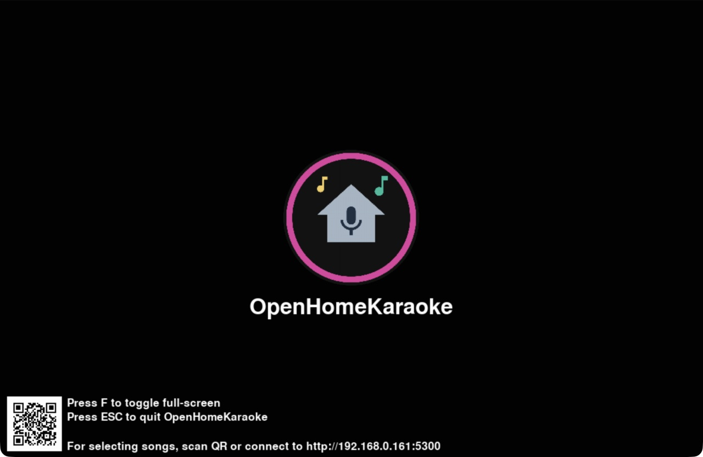
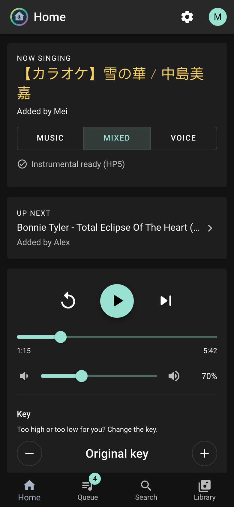
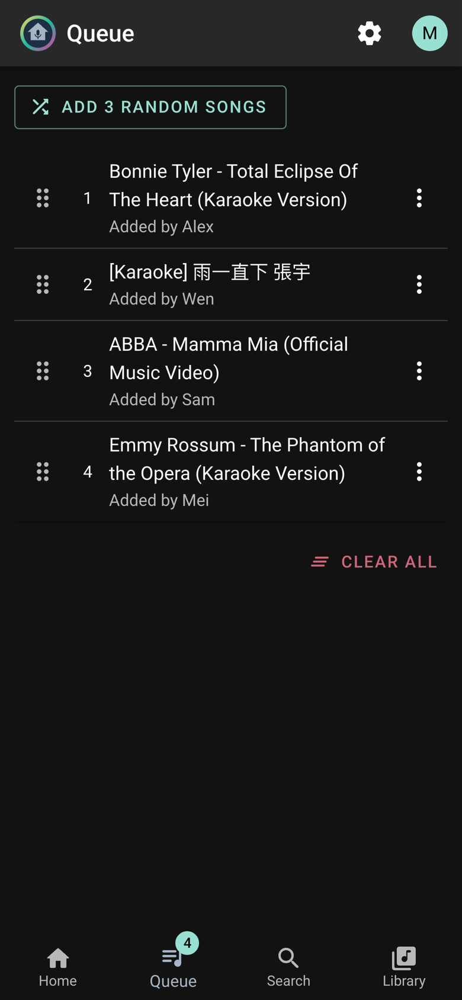
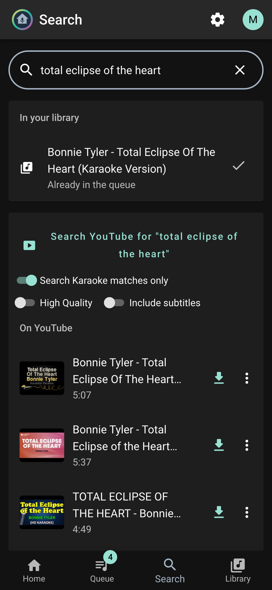
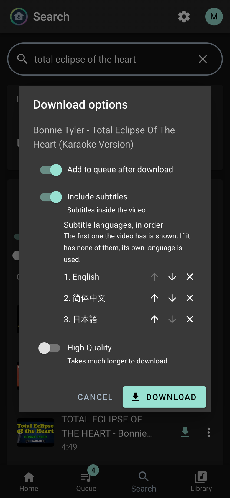
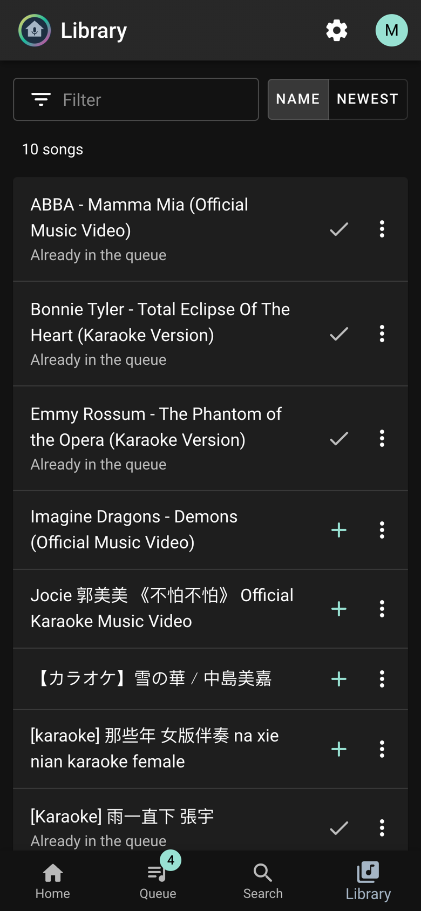
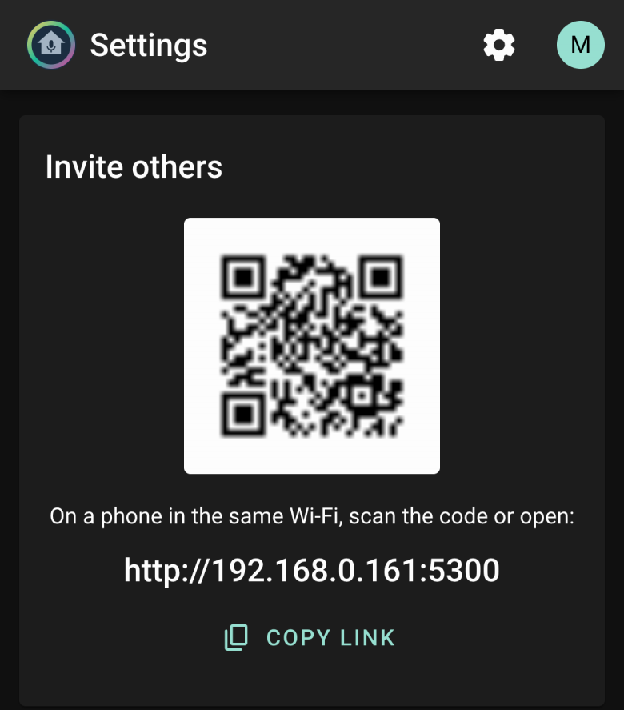

# OpenHomeKaraoke 【开源之家卡啦OK】 (The World's best open-source Home Karaoke system)

OpenHomeKaraoke is a "KTV"-style karaoke system: search, download and queue songs from your phone, and sing along on the TV. It runs on a PC, Mac or Raspberry Pi. The picture goes to the TV over HDMI, screen sharing / AirPlay, or the TV's web browser (the player is screen-captured and streamed over HTTP). The TV shows a QR code; everyone in the same Wi-Fi scans it and gets the web page, where they can search your song library, queue songs, and download new ones from YouTube and many other sites.

It started as PiKaraoke, forked from @vicwomg's repo (thanks to https://github.com/vicwomg/pikaraoke/), and was thoroughly revamped. It removes the vocals with neural networks (UVR5's VR models, and @tsurumeso's vocal remover, thanks to https://github.com/tsurumeso/vocal-remover), talks to phones over WebSockets to save bandwidth, and supports voice search. It works on Linux, Windows, Raspberry Pi and macOS.

This repository continues Wang Xuancong's [OpenHomeKaraoke](https://github.com/xuancong84/OpenHomeKaraoke) as a separate project, with a new web page, a choice of vocal removal models, Apple Silicon support and many fixes. See [CHANGELOG.md](CHANGELOG.md) for everything that changed since. Like the original, it is licensed under the [GPL-3.0](LICENSE).

See a demo on YouTube: [](https://www.youtube.com/watch?v=kmQax0EhAxE)

## Key Features

- **Vocal removal** in the background with neural networks: UVR5's VR models HP5 (removes the lead vocal only, default), HP2 or HP3 (all vocals), a lighter baseline model, or the classic L-R stereo trick. Switch between Music, Mixed and Voice while singing. Uses an NVIDIA GPU (CUDA) or Apple Silicon GPU (MPS) when there is one.
- **Web page for every phone and computer** (React + Material UI, dark or light), for many people at once
- Search your library as you type, then YouTube; or paste a link from YouTube, Bilibili, Youku and the other sites yt-dlp supports
- **High quality and subtitles remembered per phone**; subtitles in the languages you choose, in your order (the video's own language if it has none of them)
- **Fewer refused YouTube downloads** with the optional PO token service (bgutil). If YouTube still refuses, the phone says so plainly and suggests what to do instead. Signing in with browser cookies is available but experimental.
- Voice search with OpenAI's Whisper multi-lingual speech recognition (needs a speech server, `--cloud`)
- Queue management: drag a song to any position, take back your own songs, add 3 random songs
- Pause / skip / restart, seek (practice one line over and over), volume
- Key change (pitch shifting) and tempo change (playback speed)
- Audio delay and subtitle delay, remembered per song (YouTube MVs with lyrics often come too late to read)
- Volume normalization (all songs equally loud)
- Admin mode to lock down queue editing, player controls, song editing and shutdown
- mp3 + cdg support, including compressed .zip bundles
- Song titles in any language (Chinese, Japanese, Arabic, Greek, Korean, Vietnamese, Hindi, …), sorted by their Latin transliteration
- Web page and TV screen in many languages
- Splash screen with the QR code and "Next up"
- Rename and delete downloaded songs
- Stream-to-HTTP lets any TV with a web browser show the karaoke (on Windows and macOS you can also use screen projection and AirPlay)
- Speech recognition and vocal removal can run on another computer with a GPU ("cloud")

## Screenshots

### TV

<p float="left">
  
  
</p>

### Web page (phone)

<p float="left">
  
  
  
  
  
  
</p>

## Supported Devices

Linux, Windows, macOS and Raspberry Pi (3 and newer, multi-core models recommended). Day-to-day development happens on Linux and macOS (Apple Silicon); Windows is expected to work but is tested less. On a Pi, concurrent downloads and very large libraries can be slow.

## Installation

**Step-by-step guides in plain language (Python venv, no conda): [English](doc/deploy-guide-en.md) · [台灣華語](doc/deploy-guide-zh-TW.md).** They also cover vocal removal, GPUs, updating and what to do when something goes wrong. In short:

1. Install **Python 3.12** (not newer: `pygame` 2.5.2 and `numpy` 1.26.4 have no packages for 3.13+), **VLC**, **ffmpeg** and **git**.
   - Ubuntu 24.04, Linux Mint 22: `sudo apt install python3.12 python3.12-venv vlc ffmpeg git` (systems without a `python3.12` package, e.g. Raspberry Pi OS: see the guides, they use `uv`)
   - macOS (Homebrew): `brew install python@3.12 ffmpeg git` and `brew install --cask vlc`
   - Windows: Python 3.12 from python.org (tick "Add python.exe to PATH"), VLC from videolan.org, then `winget install Gyan.FFmpeg` and `winget install Git.Git`
2. Get the program and make a venv:
   ```bash
   git clone https://github.com/e-stjernstrom/OpenHomeKaraoke.git
   cd OpenHomeKaraoke
   python3.12 -m venv .venv
   source .venv/bin/activate        # Windows: .venv\Scripts\Activate.ps1
   ```
3. Install the add-ons. `requirements.txt` has everything, including the CUDA build of PyTorch for vocal removal (several GB). For the karaoke alone, the guides list a much smaller set.
   ```bash
   pip install -r requirements.txt
   ```
4. Optional, recommended: the **PO token service** for YouTube downloads (needs git and Node.js 22 or newer). Run once; the karaoke then starts it by itself (on 127.0.0.1:4416).
   ```bash
   python scripts/setup_bgutil.py
   ```
5. Optional: **vocal removal** needs PyTorch, librosa and soundfile (see the guides, step 5). The splitter then starts by itself. The HP models (about 63 MB each, MIT licensed, from `huggingface.co/lj1995/VoiceConversionWebUI`) are downloaded the first time they are needed.

Songs go to `~/pikaraoke-songs` by default (created the first time; `-d` for another folder). Its `vocal` and `nonvocal` sub-folders hold the separated tracks, stored per model (`nonvocal/HP5/<song>.m4a`, …).

## Launch

With the venv active, in the program folder:

```bash
python app.py -w
```

`-w` starts in a window; press **F** on the karaoke screen for full screen and **Esc** to quit. Without `-w` it starts in full screen.

- **macOS:** VLC plays inside the karaoke window, and full screen gets its own Space, so Cmd+Tab and the volume overlay keep working. If port 5000 is taken (AirPlay Receiver uses it), the next free port is used and the QR code shows it.
- **Raspberry Pi** from the console (no desktop): run as root, since pygame draws straight to the screen: `sudo .venv/bin/python app.py`. You may need `-d` for the song folder.
- **Linux with streaming to the TV's browser:** `./run.sh` starts the karaoke and `screencapture.sh` (port 4000) in a tmux session.

The TV shows the splash screen with a QR code and the address. Open it on a phone in the same Wi-Fi, and you're in.

## Command-line options

The ones most people need. `python app.py --help` lists them all.

| Option | What it does |
| --- | --- |
| `-w`, `--windowed` | Start in a window instead of full screen |
| `-d PATH` | Song folder (default `~/pikaraoke-songs`) |
| `-p PORT` | Web port (default 5000; the next one is used too, for HTTPS) |
| `-L LANG` | Language of the TV screen, e.g. `zh_CN`, `en_US` (default: the system's) |
| `-hq`, `--high-quality` | Download in higher quality by default (phones can still choose per download) |
| `--no-vocal` | Don't start the vocal splitter (existing instrumental tracks still play) |
| `--no-pot` | Don't start the PO token service |
| `-c BROWSER` | **Experimental:** download signed in to YouTube with a browser's cookies (`chrome`, `firefox`, `auto`, or a `cookies.txt` file). YouTube may restrict an account that downloads a lot; use a spare one. Off by default. |
| `--admin-password PW` | Lock queue editing, player controls, song editing and shutdown behind a password (otherwise everyone is admin) |
| `-nv`, `--normalize-vol` | Make all songs equally loud |
| `--ssl` | Use HTTPS (browsers only allow the microphone for voice search over HTTPS) |
| `-C URL`, `--cloud URL` | Speech recognition and vocal removal server on a GPU machine |
| `--vlc-path PATH` | Where VLC is, if not in the usual place |
| `--hide-ip`, `--hide-splash-screen`, `--show-overlay`, `--logo-path` | Splash screen and overlay options |
| `--use-omxplayer`, `--adev`, `--dual-screen` | Old Raspberry Pi players and audio outputs |

## Web UI

One page for phones and computers, in dark or light, with the bottom bar on phones and tabs on wide screens.

### Home

- Now singing and up next, with play/pause, restart, skip, position and volume
- Music / Mixed / Voice switch, with one line saying whether the instrumental is ready, being made (with progress) or waiting
- Key (−/+ semitones) and speed; audio and subtitle delay under "Fine-tune"

### Queue

- Drag the handle to reorder, or use ⋮ (move to top, up, down, remove with undo); admin only when an admin password is set
- Everyone can take back their own songs
- Add 3 random songs, clear the queue

### Search

- Your library first, as you type; then search YouTube. One tap downloads a result and adds it to the queue.
- The High Quality and Include subtitles switches are remembered on each phone. ⋮ opens the download options, including the subtitle languages in order of preference.
- Paste a link (YouTube, or another site yt-dlp supports, e.g. Bilibili) to download it, with progress; some sites refuse downloads
- Voice search when a speech server is set up (`--cloud`, HTTPS)

### Library

- All songs, filter and sort by name or newest; rename and delete (admin)

### Settings (gear icon)

- QR code and address to share, admin login
- Vocal removal on/off and model, volume normalization, TV screen language, rescan the song folder
- System info, update yt-dlp, quit / reboot / shut down. Always shut down from here before you pull the plug!

## Troubleshooting

### YouTube refuses downloads ("confirm you're not a bot")

YouTube judges mostly by the network: shared, work and school networks are refused more often. The phone then shows what happened and what to do; retrying right away is usually refused too.

- Install the PO token service (`python scripts/setup_bgutil.py`, see Installation). At startup the karaoke prints `PO token provider: bgutil … started`. It makes refusals rarer but cannot rule them out.
- Wait 30 minutes to a few hours, or connect the karaoke computer to another network (e.g. a phone's hotspot).
- Last resort, experimental: `-c chrome` (or `firefox`) downloads signed in to YouTube. Use a spare account, since YouTube may restrict accounts that download a lot. On macOS, the terminal you start the karaoke from needs Full Disk Access to read Chrome's cookies. See the guides for details and for `cookies.txt` files.

### Songs aren't downloading (other errors)

Make sure yt-dlp is up to date: sites change often and old versions fail. The karaoke checks for a new yt-dlp once a day at startup. Settings → System info shows the version, and you can update it from there too. From the command line, with the venv active: `pip install -U yt-dlp`.

### The phone shows a blank page or can't connect

- Same Wi-Fi? Guest networks often keep devices apart.
- Use the address the TV shows (it may not be port 5000: on macOS, AirPlay Receiver takes port 5000 and the karaoke moves on).
- Allow the program through the computer's firewall. The guides show how for each system.

### Music / Voice are greyed out

The vocal/nonvocal play modes need the `vocal` and `nonvocal` folders inside the song folder. They are created the first time a song folder is used. If you deleted them (which turns vocal splitting off), create the two sub-folders again. Otherwise the song hasn't been separated yet: Home says whether it is being made or waiting.

### I'm not hearing audio out of the headphone jack (Raspberry Pi)

By default Raspberry Pi OS sends sound to HDMI when it's available. To force the headphone jack: `sudo raspi-config` → Advanced Options → Audio → Force 3.5mm (headphone). See https://www.raspberrypi.org/documentation/configuration/audio-config.md

If you still hear nothing, this has helped on Raspberry Pi 4: `sudo nano /usr/share/alsa/alsa.conf`, scroll down and set:

```
defaults.ctl.card 1
defaults.pcm.card 1
```

The value may differ on older systems or with external audio hardware. Source: https://raspberrypi.stackexchange.com/a/39942

### Audio problems with omxplayer

With `--use-omxplayer`, results vary across hardware. Try the `--adev` option: `hdmi`, `local`, `both` (default), or `alsa[:device]`. For distorted sound try `--adev alsa`; for a USB sound card or a HiFi hat like the HiFiBerry, `--adev alsa:hw:0,0`.

### I brought my Pi to a friend's house. How do I change the Wi-Fi without ssh?

- _Completely headless_: https://github.com/jasbur/RaspiWiFi detects when there is no network and becomes a Wi-Fi access point, so you can set up Wi-Fi from your phone (like a Chromecast). With a button on GPIO18 and 3.3V you even get a Wi-Fi reset button.
- _USB keyboard_: log in and run `sudo raspi-config` → Network Options, or set it up in the desktop.
- _SD card reader_: on the card's BOOT partition, add a plain text file named `wpa_supplicant.conf`:

```
ctrl_interface=DIR=/var/run/wpa_supplicant GROUP=netdev
update_config=1
country=<Your 2-letter country code, ex. US>
network={
  ssid="<the wifi ap ssid name>"
  psk="<the wifi password>"
  key_mgmt=WPA-PSK
}
```

On the next boot the Pi moves it to the right place and connects.

### Can I use it without Internet?

Yes, with the songs you already have. Searching and downloading need the Internet, of course. If the Pi runs as a Wi-Fi access point (https://www.raspberrypi.org/documentation/configuration/wireless/access-point.md, or RaspiWiFi above, which serves at http://10.0.0.1:5000), phones connect to it directly.

## For developers

### How to change the web page?

The page lives in `frontend/` and is built into `static/app/`, which is committed, so users don't need Node.js. To change it, install Node.js 20.19 or newer, then:

```
cd frontend
npm install
npm run dev     # live preview on http://localhost:5173, talking to OpenHomeKaraoke on port 5000 (set OHK_URL for another address)
npm run build   # type-check and write static/app/; commit the result
```

New text goes to the end of `lang/en_US` (and `lang/zh_CN`, `lang/zh_TW`), with its line number in `frontend/src/strings.ts`. Other languages fall back to English line by line.

### How to refresh Google translation?

Pip install py-googletrans: `pip install googletrans==3.1.0a0`

Edit `lang/en_US` and `lang/zh_CN` by hand, then run `./translate-all.sh -c` to re-generate the Google translations for the rest. To just add a new language from Google Translate, leave out `-c`.
